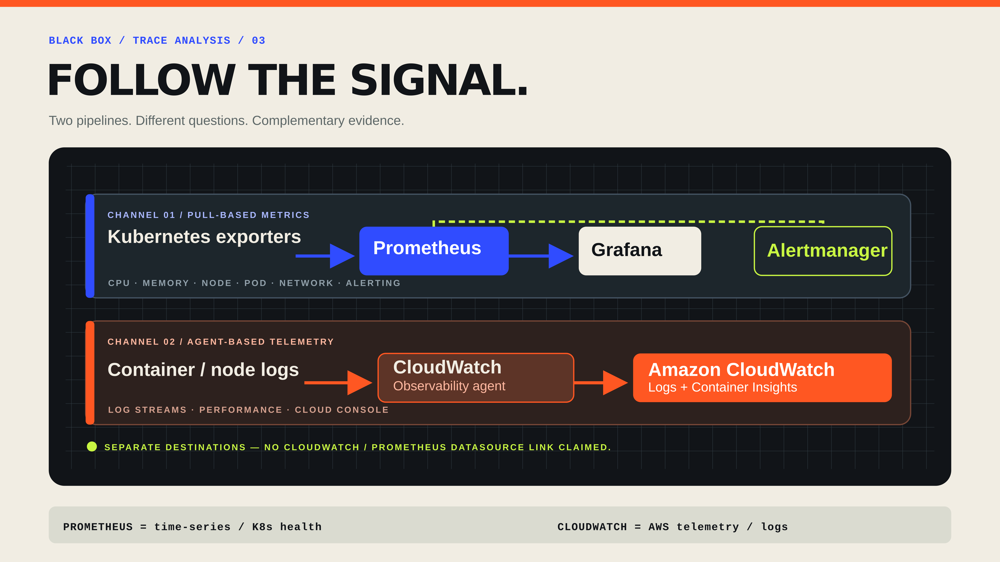
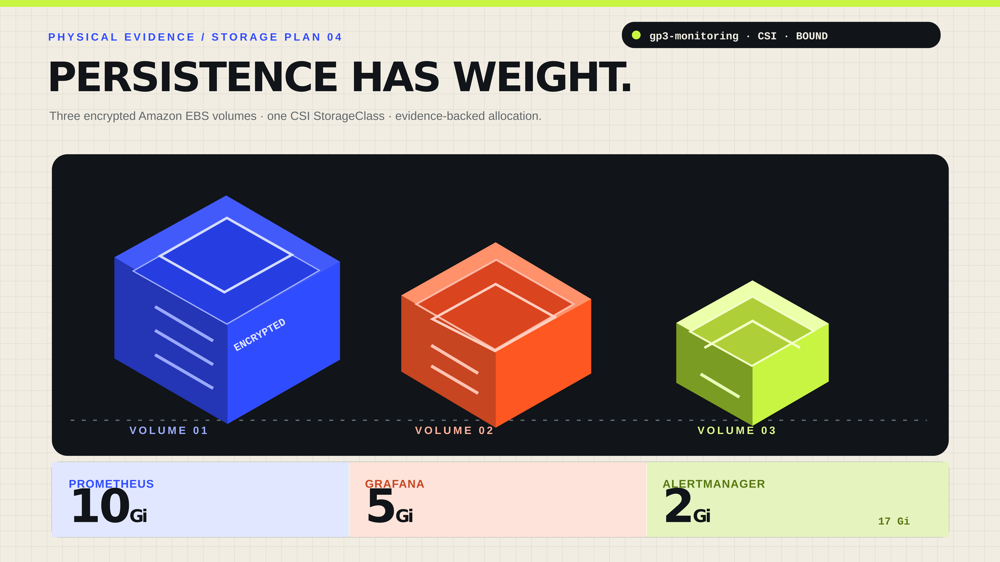
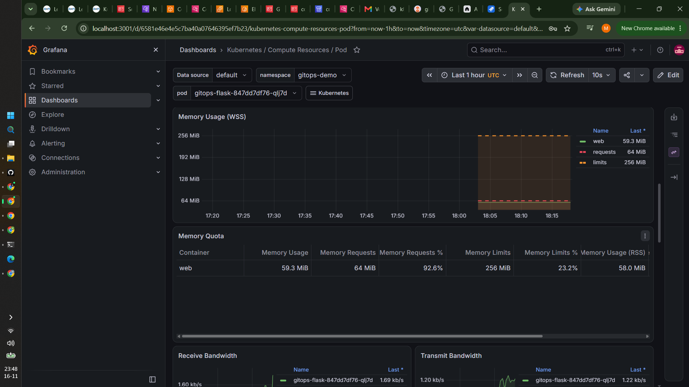

# Engineering deep dive — The Cloud's Black Box

> This is a **documented lab** drawn from actual user-provided AWS CLI, kubectl, Helm outputs and screenshots. It does not assert that the reviewer has access to the live AWS account.

## 1. Motivation and boundaries

An existing EKS GitOps lab already hosted a Flask application in `gitops-demo` (2/2 deployment availability) and Argo CD controllers in `argocd`. The goal was to gain **operational visibility** without replacing the GitOps application or relying on Windows-local Grafana.

**In scope:** AWS Container Insights, a cloud-hosted Prometheus/Grafana/Alertmanager deployment, persistent EBS storage, verified Kubernetes/container metrics and Prometheus rule evaluation.

**Not implemented:** public HTTPS Grafana, outbound notification receivers, automatic application tracing, disaster recovery, autoscaling or full infrastructure provisioning.



## 2. Environment at the recorded session

| Item | Observed setting |
| --- | --- |
| AWS region | `us-east-1` |
| EKS cluster | `gitops-eks-cluster` |
| Kubernetes | `1.37` |
| Managed nodegroup | `gitops-eks-workers-1` |
| Worker capacity | 2 × `c7i-flex.large`, On-Demand |
| Existing workload | `gitops-flask` in `gitops-demo`, 2 Running pods |
| GitOps | Argo CD running in `argocd` |
| Monitoring Helm release | `monitoring` in namespace `monitoring` |
| Helm chart | `kube-prometheus-stack` chart version `93.3.0` |
| Grafana UI | EKS-hosted, accessed locally using port-forward on 3001 |
| Prometheus UI | EKS-hosted, accessed locally using port-forward on 9091 |

Nodegroup status from the lab:

```text
Status: ACTIVE
Health: issues []
Scaling: minSize=2, maxSize=2, desiredSize=2
InstanceTypes: [c7i-flex.large]
CapacityType: ON_DEMAND
```

This is a **historical snapshot**, not continuously verified.

## 3. AWS-native observability first

The EKS managed add-on `amazon-cloudwatch-observability` was installed as version `v7.0.1-eksbuild.1`. Its final described state was:

```text
Status: ACTIVE
Health.issues: []
PodIdentity: associated
```

CloudWatch Agent and Fluent Bit workloads were Running in `amazon-cloudwatch`. The add-on configuration deliberately disabled blanket Application Signals auto-monitoring:

```json
{"manager":{"applicationSignals":{"autoMonitor":{"monitorAllServices":false}}}}
```

**Why:** Avoid surprising automatic monitoring/instrumentation of existing GitOps services during a separate observability lab. This setting does not stop Kubernetes metrics or CloudWatch Agent/Fluent Bit collection.

CloudWatch Container Insights screenshots showed two available nodes, 27 desired/27 ready pods at the captured time and CPU/memory/utilization visualizations. Application log streams included `gitops-flask` entries; performance log streams existed for both workers.

**Known cost caveat:** `/aws/containerinsights/gitops-eks-cluster/{application,dataplane,host,performance}` groups showed `RetentionDays: None`. No retention change was made in this project. See [security & costs](docs/08-security-costs-limitations.md).

## 4. EBS persistent storage engineering

Initially, `kubectl get csidrivers` showed only `efs.csi.aws.com`, and the default `gp2` StorageClass used the old in-tree EBS provisioner. The managed EBS CSI add-on was installed separately and verified.

```text
Add-on: aws-ebs-csi-driver
Version: v1.68.0-eksbuild.1
Status: ACTIVE
Health.issues: []
CSI driver registered: ebs.csi.aws.com
Controllers: 2 × 6/6 Running
Node DaemonSet pods: 2 × 3/3 Running
```

The `gp3-monitoring` StorageClass was created with:

- `provisioner: ebs.csi.aws.com`
- `type: gp3`
- `encrypted: "true"`
- `volumeBindingMode: WaitForFirstConsumer`
- `allowVolumeExpansion: true`
- `reclaimPolicy: Delete`

The user created a disposable 1 GiB PVC and pod in `monitoring`. Recorded proof:

```text
gp3-smoke-test-pvc   Bound   1Gi   RWO   gp3-monitoring
gp3-smoke-test       1/1     Running
kubectl logs -n monitoring gp3-smoke-test
EBS_MOUNT_OK
```

The disposable pod and PVC were deleted **before** installing the monitoring chart. We will not recreate this destructive test in an occupied namespace without explicit permission.



## 5. Monitoring stack installation

The chosen chart was `prometheus-community/kube-prometheus-stack`, pinned at `93.3.0` (observed app version `v0.95.2`). It provisions a Prometheus Operator and supporting dashboards/exporters in addition to Prometheus, Grafana and Alertmanager.

The pinned chart can be deployed on a **separate, properly authorized cluster** using this reference pattern from the repository root (not a verbatim export of the operator's command history):

```powershell
helm repo add prometheus-community https://prometheus-community.github.io/helm-charts
helm repo update
helm install monitoring prometheus-community/kube-prometheus-stack --version 93.3.0 --namespace monitoring --create-namespace -f ".\manifests\monitoring-values.yaml" --wait --timeout 15m
```

**Do not run again on the existing deployed release**. For a fresh cluster, review prerequisites, permissions, storage and values; for an existing release, inspect with `helm get values` and `helm list` first. The included `manifests/monitoring-values.yaml` is **a reference reconstruction**, not an authenticated Helm release export.

The configured storage requests were:

| Component | PVC | Retention |
| --- | --- | --- |
| Prometheus | 10 GiB GP3 | 3 days, 8 GB cap configured |
| Grafana | 5 GiB GP3 | Persistent Grafana state |
| Alertmanager | 2 GiB GP3 | Persistent Alertmanager data |
| **Total** | **17 GiB** | EBS charges apply |

All three claims were reported `Bound` under `gp3-monitoring`.

## 6. Verified workload status

The terminal output from the successful lab showed `helm list -n monitoring`:

```text
NAME        NAMESPACE  STATUS    CHART                         APP VERSION
monitoring  monitoring deployed  kube-prometheus-stack-93.3.0  v0.95.2
```

And the following seven pods were Running, with zero restarts in the captured output:

```text
alertmanager-monitoring-kube-prometheus-alertmanager-0   2/2 Running
monitoring-grafana-7b668ddf9c-k49j4                      3/3 Running
monitoring-kube-prometheus-operator-b7485958-76fbd       1/1 Running
monitoring-kube-state-metrics-7d94c4cbd8-w8lxz           1/1 Running
monitoring-prometheus-node-exporter-2tx6m                1/1 Running
monitoring-prometheus-node-exporter-7qfkv                1/1 Running
prometheus-monitoring-kube-prometheus-prometheus-0       2/2 Running
```

Those observations do not mean zero restarts forever; they represent that particular check.

## 7. Actual application metrics, not just pod status

The Grafana dashboard **Kubernetes / Compute Resources / Pod** was set to:

- Namespace: `gitops-demo`
- Pod: `gitops-flask-847dd7df76-qlj7d`
- Container: `web`

It displayed:

| Metric | Captured value |
| --- | --- |
| CPU usage | approx. `0.000457` cores |
| CPU request | `0.050` cores |
| CPU limit | `0.250` cores |
| CPU throttling | 0% displayed |
| Memory working set | approx. `59.3 MiB` |
| Memory request | `64 MiB` |
| Memory limit | `256 MiB` |
| Receive bandwidth | approx. `1.69 kb/s` |
| Transmit bandwidth | approx. `1.22 kb/s` |

The memory value is **92.6% of the request** but only **23.2% of the limit**. A high request utilization percentage on its own is **not** an out-of-memory event. Additional history and load testing would be needed for capacity conclusions.



## 8. Scrape health and alert rules

Prometheus `Status > Target health` showed selected Grafana, Alertmanager, CoreDNS, kubelet, API server, node exporter and other targets **UP**. The captured instant query:

```promql
up == 0
```

returned **0 result series**.

This means no *currently discovered and scraped* target had `up=0` **at that query moment**. It cannot prove that undiscovered/missing endpoints never existed, nor does it establish zero future failures.

The screenshot of `/alerts` showed `alertmanager.rules` loaded, with the displayed rules marked **INACTIVE**. This verifies rule loading/evaluation view, **not** real-world notification delivery.

The standard alerting chain is Prometheus rules → Alertmanager routing → an explicitly configured receiver. In this lab, outbound receivers were not demonstrated.

## 9. Key troubleshooting lessons

1. **EKS access ≠ unrestricted Kubernetes RBAC.** The `kubernetes` IAM principal initially had an `AmazonEKSEditPolicy` namespace scope and `kubectl auth can-i create customresourcedefinitions...` returned `no`. After authorized access change it returned `yes`. Cluster-admin is much broader than namespace edit; restore least privilege after administrative setup.
2. **StorageClass alone is not storage.** Installing the EBS CSI controller and its IAM Pod Identity, then testing dynamic provisioning, prevented Helm PVC blockers.
3. **CloudWatch telemetry and Prometheus are different pipelines.** They can coexist, but a CloudWatch dashboard is not evidence that Prometheus scrapes CloudWatch.
4. **An Alertmanager pod is not a tested notification.** Verify routes, receivers and at least one synthetic alert in a separate future exercise.
5. **Grafana on EKS is not the same as a public cloud URL.** `kubectl port-forward` creates a PC/session-dependent tunnel.

## 10. Risks, costs and next steps

- CloudWatch log retention appeared unset; configure retention *only with explicit authorization*, because retention deletes older logs.
- EKS control plane, EC2 On-Demand nodes, CloudWatch ingestion/retention and encrypted GP3 EBS cost money while running.
- `reclaimPolicy: Delete` can erase volumes on deletion. Do not remove monitoring PVCs just to tidy a portfolio.
- Verify authorization and remove **only** any temporary excessive EKS cluster-admin policy after confirming the precise target. Preserve required existing roles/entries.
- Keep `Service.type: ClusterIP` and loopback port-forward; do not casually publish Prometheus or Alertmanager on the internet.
- No raw Grafana passwords, IAM access keys, kubeconfigs or cloud credentials are part of this repository.

**Next improvements, explicitly not implemented:** alert receiver end-to-end tests, separate app-specific SLO alerts, secure remote access, log retention policy, dashboard regression checks, backups and restore exercises.

## 11. Source and reproducibility standard

This portfolio was assembled from actual lab screenshots and pasted terminal output. It deliberately separates three classes of information:

- **Verified from screenshots:** CloudWatch charts, Grafana charts, Prometheus target states/query, alert UI.
- **Recorded from user-provided CLI text:** add-on status, worker status, Helm release, pod list, PVC binding, smoke-test output.
- **Reference assets created for this portfolio:** technical SVG illustrations, scripts and reconstructed Helm values.

For a live configuration export, use `helm get values monitoring -n monitoring -o yaml` and compare locally. This repository is not a live-state audit and not a complete IaC recreation.
