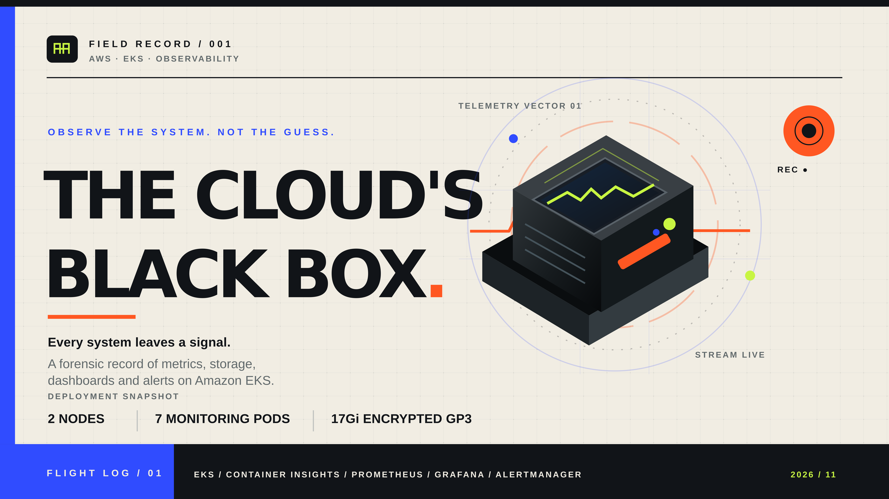
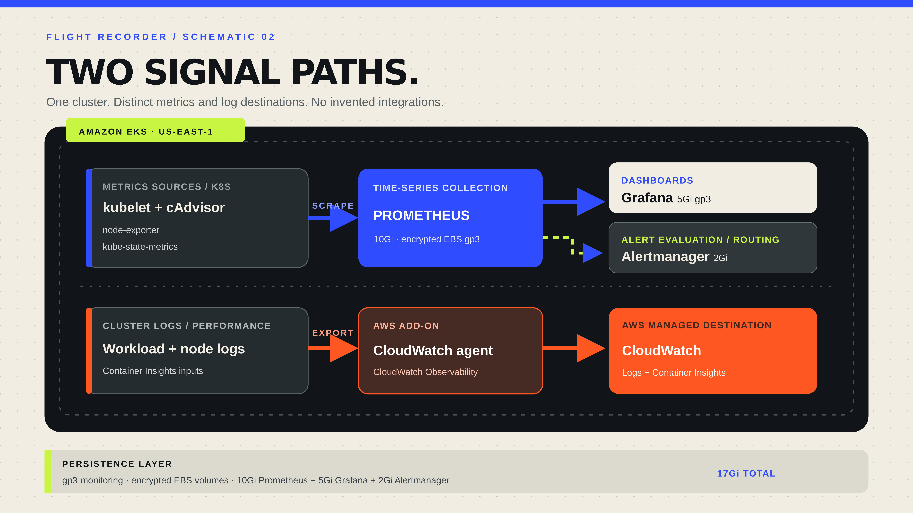
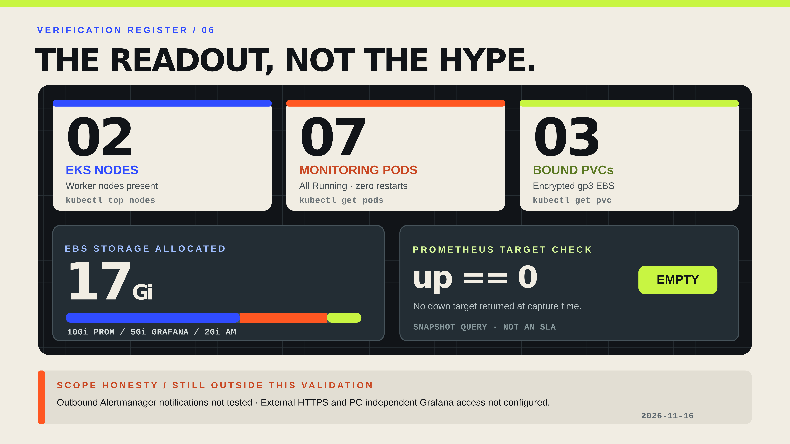
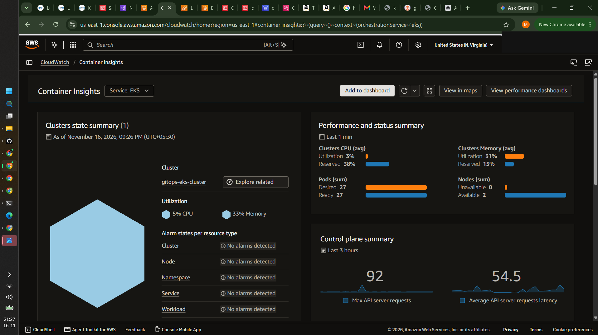
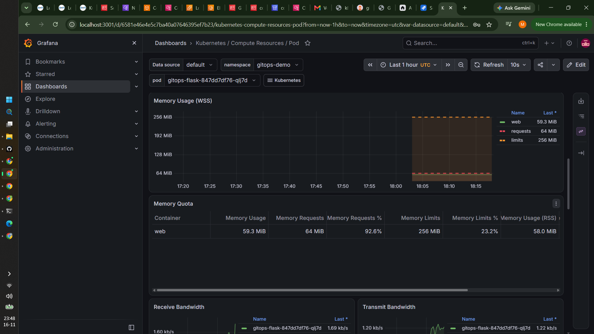
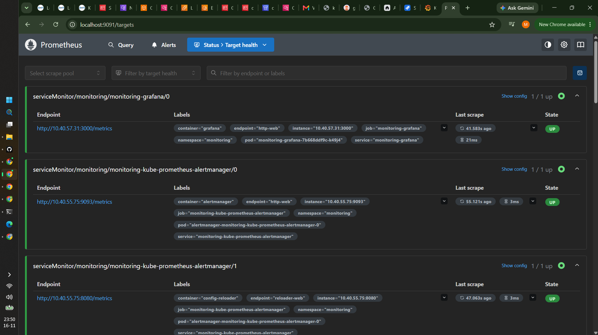

# THE CLOUD'S BLACK BOX



> **Every system leaves a signal.** An evidence-led AWS EKS monitoring and observability portfolio.

**Scope:** Amazon EKS · Kubernetes · Helm · Prometheus · Grafana · Alertmanager · Amazon CloudWatch Container Insights · EBS CSI · encrypted GP3 storage · existing Argo CD / Flask workload

**Captured:** 16 November 2026 (IST) · **Cluster:** `gitops-eks-cluster` · **Region:** `us-east-1` · **Project type:** educational, production-style lab

## The question

A deployment can show `2/2 Available` while saying very little about *why* an application is healthy, how it uses memory, or whether observability endpoints are reachable. This project extended an existing AWS EKS + Argo CD GitOps environment with a separate monitoring stack, without replacing or restarting the application.

## What was verified

| Layer | Evidence-based outcome |
| --- | --- |
| Amazon EKS | Kubernetes **1.37**, two managed EC2 worker nodes |
| Existing GitOps Flask | Two replicas running in `gitops-demo` before monitoring changes |
| AWS observability | CloudWatch Observability add-on **v7.0.1-eksbuild.1**, Active / no health issues |
| Metrics & dashboards | `kube-prometheus-stack` Helm chart **93.3.0** deployed in `monitoring` |
| Storage | EBS CSI add-on **v1.68.0-eksbuild.1**; GP3 PVCs **10 GiB + 5 GiB + 2 GiB**, Bound |
| Monitoring workloads | Seven observed monitoring pods Running, zero restarts at capture |
| GitOps dashboard | Real Flask CPU, memory and network measurements visible in Grafana |
| Prometheus targets | Captured displayed targets `UP`; `up == 0` returned no series at the check time |
| Alerting | Built-in Prometheus rules loaded; outbound notification delivery **not verified** |

These are **historical lab observations**, not a continuously updating status page.



## Two distinct telemetry paths

```text
EKS nodes and pods
  ├─ kubelet/cAdvisor, node-exporter, kube-state-metrics
  │      └─ Prometheus ──> Grafana dashboards
  │                     └─ Alert rules ──> Alertmanager (receiver not tested)
  └─ CloudWatch Agent + Fluent Bit
         └─ CloudWatch Container Insights and log groups

Monitoring state ──> encrypted GP3 EBS volumes
```

**Important:** CloudWatch is **not** shown as a Prometheus data source: that integration was not part of the verified lab. Prometheus primarily collects the Kubernetes/exporter metrics.

## Engineering results



- **Monitoring stack deployment:** Helm release `monitoring` reported `deployed`.
- **Persistence:** Three PVCs bound to `gp3-monitoring`, after a successful `EBS_MOUNT_OK` smoke test.
- **Application metrics:** Grafana displayed `gitops-flask` container CPU, memory and network.
- **Healthy scrape endpoints:** Prometheus target screenshots display `UP`; the instantaneous `up == 0` query returned an empty vector.
- **Preserved GitOps workload:** App deployment was verified independently, with no evidence of monitor-induced restarts.

## Selected real evidence

| AWS CloudWatch | GitOps Grafana | Prometheus |
| --- | --- | --- |
|  |  |  |
| EKS resource visibility | Flask memory request and usage | Grafana and Alertmanager scrape targets |

See **[the 13-item evidence index](EVIDENCE-INDEX.md)** for the original captured screenshots and what each actually supports.

## Repository map

| Path | Purpose |
| --- | --- |
| [DEEP-DIVE.md](DEEP-DIVE.md) | Full chronology, decisions, verification and lessons |
| [docs/](docs/01-project-overview.md) | Nine focused operational/technical runbooks |
| [graphics/](graphics/01-hero.svg) | Six original editable SVG diagrams with PNG exports |
| [evidence/](EVIDENCE-INDEX.md) | Thirteen authentic session captures, not simulated dashboards |
| [manifests/](manifests/monitoring-values.yaml) | Reference configurations, with reproduction caveats |
| [queries/](queries/cluster-health.promql) | PromQL examples used for validation |
| [scripts/](scripts/verify.ps1) | Read-only PowerShell checks and local port-forwarding |

## Reproduction overview

The repository **does not provision EKS, VPC, nodes or IAM roles from scratch**. The exact Helm-values export was not supplied as a file; the included values are a carefully labelled reference reconstruction from the user-confirmed settings. Review [prerequisites](docs/02-prerequisites.md) and [runbook](docs/03-deployment-runbook.md) before considering any write operation.

```powershell
# Read-only: do this before touching an existing cluster.
kubectl get nodes
helm list -A
kubectl get storageclass gp3-monitoring
kubectl get pods,pvc -n monitoring
```

For a **new, appropriately authorized cluster only**, the pinned monitoring chart is `prometheus-community/kube-prometheus-stack --version 93.3.0`. See the full runbook and compare the reference values against the intended live environment first.

## Limitations that matter

- Grafana is **running on EKS**, but access at `localhost:3001` relies on a local `kubectl port-forward` session. No PC-independent public endpoint or HTTPS ingress was configured.
- Alertmanager is deployed and rules are loaded, but **email/Slack/webhook receivers and end-to-end notifications were not tested**.
- The Helm values are not a guaranteed byte-for-byte export of the actual release.
- The original CloudWatch log groups had **no retention period**; log ingestion and retention may incur ongoing costs.
- Worker nodes, control plane, CloudWatch and encrypted EBS volumes may incur AWS charges. The EBS StorageClass uses `reclaimPolicy: Delete`.
- An operator temporarily received cluster-admin access to install CRDs. Least-privilege access should be restored after all authorized cluster administration is complete.

See [security, cost and limitations](docs/08-security-costs-limitations.md) and [reproduction/cleanup](docs/09-reproduction-cleanup.md).

---

**Author / portfolio:** [HafizMohammadSunasara](https://github.com/HafizMohammadSunasara)

This independent observability portfolio references an existing GitOps Flask workload but does not duplicate or change the application repository.
