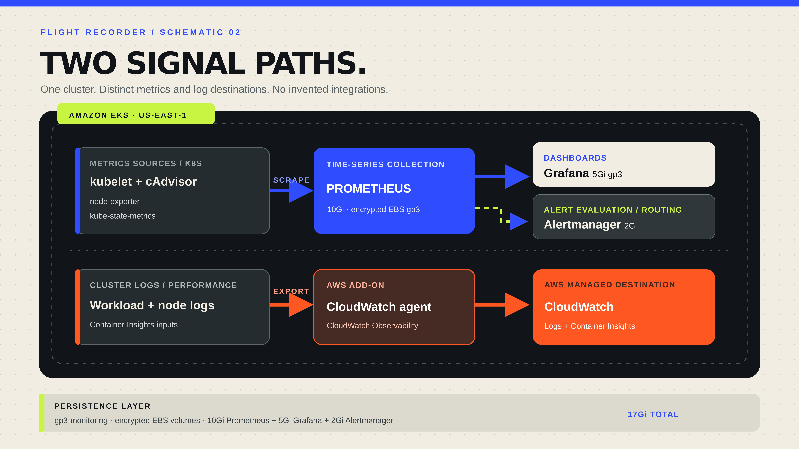
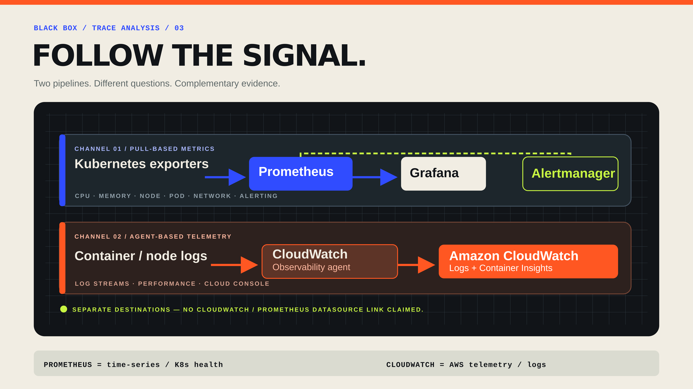
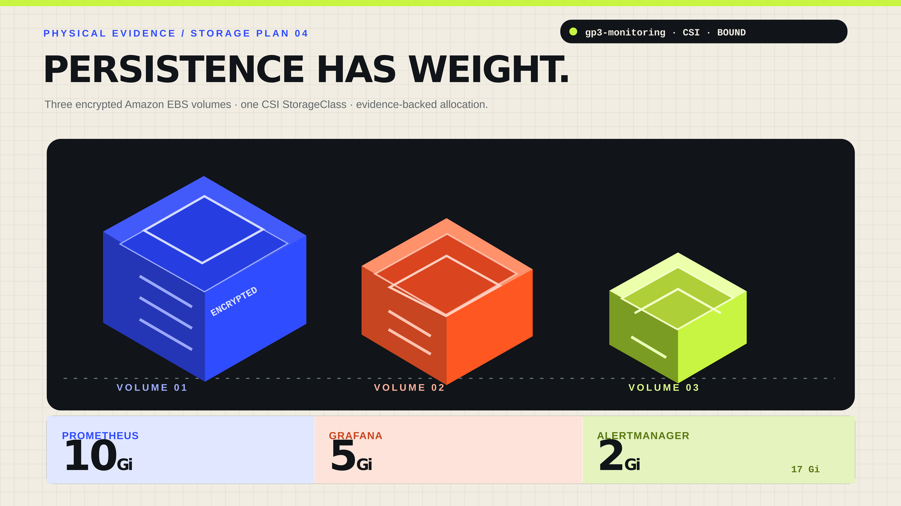

# 04 — Architecture and data flow



## Control-plane separation

The existing GitOps path (Git repository → Argo CD → application state in `gitops-demo`) remains **a deployment/reconciliation responsibility**.

The monitoring path is different:

```text
Kubernetes workload and node telemetry
  ├── kubelet + cAdvisor metrics
  ├── node-exporter
  ├── kube-state-metrics
  └── monitored Kubernetes API / CoreDNS endpoints
            │
            ▼
      Prometheus (scrape + time series + rules)
            ├──► Grafana (visual dashboards)
            └──► Alertmanager (alert routing)
```

The independent AWS path:

```text
EKS pod/node telemetry and container log files
  └── CloudWatch Agent / Fluent Bit
          └── AWS CloudWatch Container Insights / Logs
```

**No direct CloudWatch-to-Prometheus bridge was demonstrated.** Do not draw one.



## Storage plane

```text
EBS CSI driver (with AWS Pod Identity permissions)
     └── StorageClass gp3-monitoring (encrypted gp3)
          ├── Prometheus PVC    10Gi
          ├── Grafana PVC        5Gi
          └── Alertmanager PVC   2Gi
```

These are EBS-backed RWO volumes, not shared ReadWriteMany filesystems. The scheduling and attachment behavior differs from EFS and should be treated as an operational constraint.



## Trust and access boundaries

- AWS IAM principal authentication and EKS access policy association are not identical to application authorization.
- CRD installation is a cluster-scoped operation.
- Pod Identity associates a Kubernetes workload identity to an AWS role without copying long-lived AWS keys into the container.
- Grafana, Prometheus and Alertmanager were ClusterIP services with localhost-only port-forward access.
- Public HTTPS ingress, AWS Load Balancer Controller integration and SSO were not installed as part of this portfolio.

## Where to see real proof

See [EVIDENCE-INDEX.md](../EVIDENCE-INDEX.md). Architectural drawings describe the design; screenshots and terminal outputs establish observed state.
